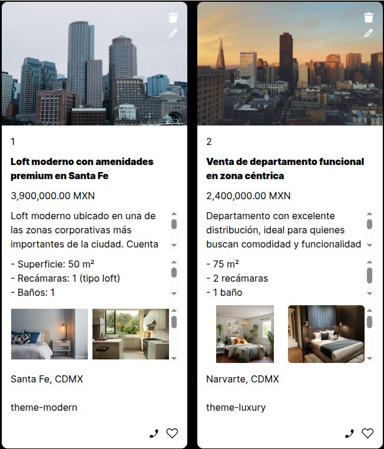
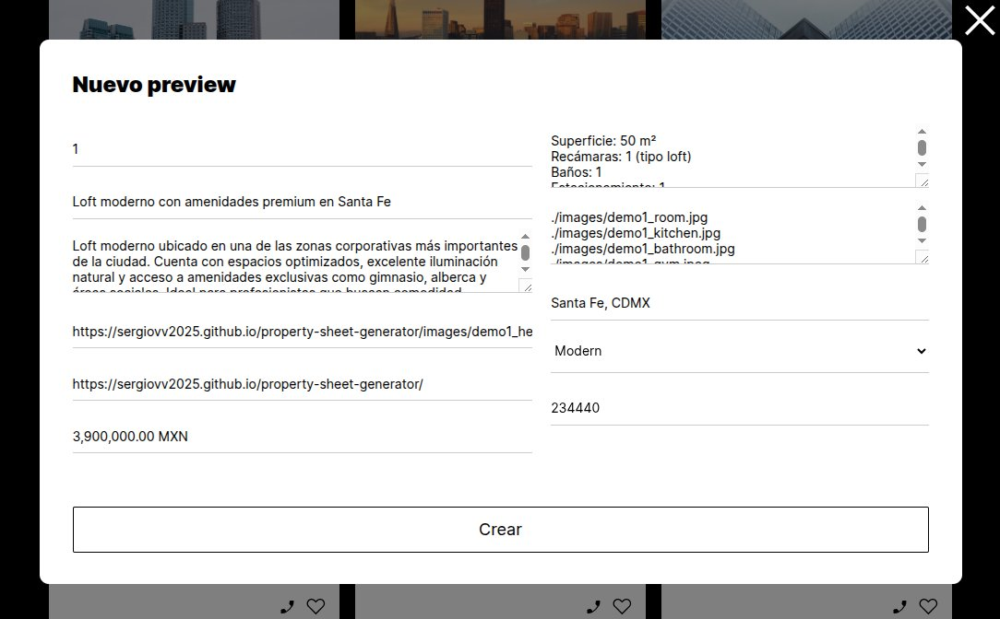
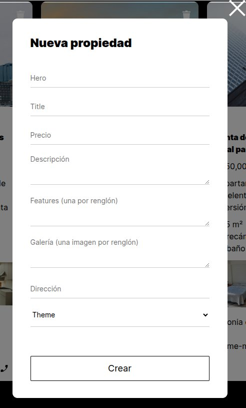
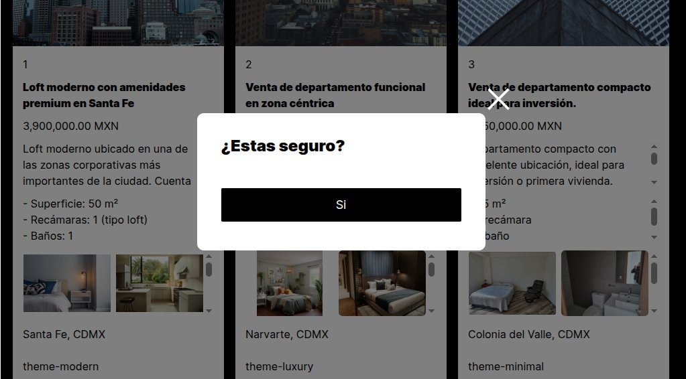
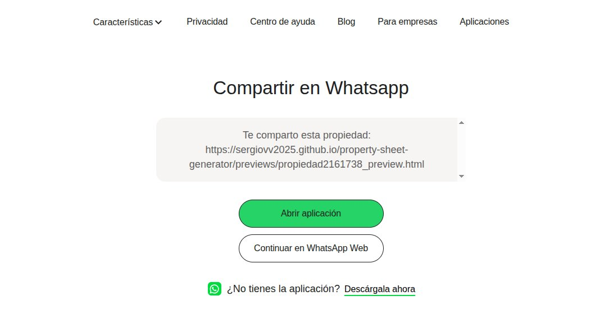

# Property Sheet Generator

**Generador de fichas inmobiliarias desarrollado con JavaScript, HTML y CSS, sin frameworks ni backend.**

Aplicación web que permite administrar información de propiedades y generar fichas de presentación con fotografías, características y enlaces para compartir.

El proyecto está orientado a simplificar la preparación de material inmobiliario mediante una interfaz de administración y plantillas visuales reutilizables.

Fue desarrollado como una aplicación frontend independiente, con persistencia local y generación de páginas HTML estáticas.

## Demo

- **[Ver aplicación](https://sergiovv2025.github.io/property-sheet-generator/)**
- **[Repositorio en GitHub](https://github.com/SergioVV2025/property-sheet-generator)**

> **Estado del proyecto:** Demo funcional. No incluye backend, base de datos remota ni publicación automática de propiedades.

## Vista previa

### Panel de propiedades



### Ficha inmobiliaria



### Creación de propiedades



### Confirmación de eliminación



### Integración con WhatsApp



### Vista previa al compartir propiedades


## Funcionalidades

### Administración de propiedades

- Crear, consultar, editar y eliminar propiedades.
- Gestionar información como descripción, precio, ubicación, características y fotografías.
- Validar formularios antes de guardar información.
- Confirmar acciones de eliminación.
- Marcar propiedades como favoritas.

### Generación de fichas inmobiliarias

- Crear páginas HTML de presentación a partir de los datos de una propiedad.
- Mostrar fotografías mediante una galería interactiva.
- Navegar imágenes con controles y gestos táctiles.
- Utilizar diferentes estilos visuales para presentar las propiedades.
- Incorporar enlaces de contacto mediante WhatsApp.
- Configurar metadatos Open Graph para compartir fichas en redes sociales y aplicaciones de mensajería.

### Persistencia y respaldo

- Guardar información mediante `localStorage`.
- Recuperar propiedades al volver a abrir la aplicación en el mismo navegador.
- Exportar e importar datos mediante archivos de respaldo.

Los datos permanecen en el navegador utilizado. No existe sincronización entre dispositivos ni almacenamiento remoto.

## Tecnologías

| Tecnología      | Aplicación                                        |
| --------------- | ------------------------------------------------- |
| HTML5           | Estructura de la interfaz y fichas generadas      |
| CSS3            | Diseño responsive, temas visuales y animaciones   |
| JavaScript ES6+ | Lógica de negocio e interactividad                |
| DOM API         | Renderizado y actualización de componentes        |
| localStorage    | Persistencia local                                |
| JSON            | Serialización, exportación e importación de datos |
| Git y GitHub    | Control de versiones                              |
| GitHub Pages    | Publicación de la demo y fichas estáticas         |

## Arquitectura

El proyecto utiliza JavaScript modular y una estructura basada en componentes, sin depender de un framework frontend.

Las principales responsabilidades están separadas en:

- **Componentes:** tarjetas, formularios, ventanas emergentes y elementos reutilizables.
- **Gestión de datos:** operaciones sobre propiedades y sincronización con `localStorage`.
- **Validación:** comprobación de los datos introducidos en formularios.
- **Generación de fichas:** construcción de documentos HTML a partir de los datos almacenados.
- **Presentación:** estilos CSS, temas visuales y comportamiento responsive.

Esta organización permite mantener separadas la lógica de administración, la generación de contenido y su presentación visual.

## Decisiones técnicas

### Frontend sin backend

La aplicación utiliza `localStorage` porque fue diseñada como una herramienta frontend independiente.

Esto permite ejecutar la demo sin configurar servidores ni servicios de bases de datos.

Como contrapartida, los datos dependen del almacenamiento del navegador y no están disponibles automáticamente en otros dispositivos.

### Fichas HTML independientes

Las fichas se generan como documentos HTML estáticos.

Este enfoque permite compartir páginas individuales sin requerir que el destinatario acceda al panel de administración.

La publicación de estos archivos y sus recursos se realiza por separado; la aplicación no dispone de un servicio de despliegue automático.

### Integración con WhatsApp

Las fichas incorporan metadatos Open Graph para definir el título, la descripción y la imagen que pueden utilizar las plataformas al generar vistas previas de los enlaces.

La visualización final depende también del procesamiento y la caché de cada plataforma.

## Preparación de fotografías

Para mejorar el rendimiento de las fichas y facilitar la generación de vistas previas en WhatsApp, se recomienda optimizar las fotografías antes de utilizarlas.

**Configuración recomendada:**

- Formato: JPG/JPEG.
- Dimensiones: ajustar proporcionalmente dentro de un máximo de 1200 × 630 píxeles.
- Peso recomendado: inferior a 300 KB.
- Calidad de compresión: aproximadamente 85 %.
- Mantener la proporción original, sin deformar ni recortar.
- Utilizar URLs públicas HTTPS para las fotografías compartidas mediante Open Graph.

Estas recomendaciones se basan en pruebas realizadas con las fichas de demostración. No constituyen requisitos oficiales ni garantizan que todas las plataformas generen una vista previa.

### Optimización con ImageMagick

```bash
convert imagen-original.jpg \
  -resize 1200x630 \
  -strip \
  -quality 85 \
  imagen-optimizada.jpg
```

Verificar el resultado:

```bash
identify -format '%m | %wx%h | %b\n' imagen-optimizada.jpg
```

El proceso mantiene la proporción original de la fotografía y evita recortes.

**Nota:** la aplicación no redimensiona ni comprime imágenes automáticamente. Su preparación corresponde al usuario.

## Instalación local

Clonar el repositorio:

```bash
git clone https://github.com/SergioVV2025/property-sheet-generator.git
cd property-sheet-generator
```

Abrir `index.html` en el navegador.

Para realizar pruebas de desarrollo, también puede utilizarse un servidor local, por ejemplo mediante la extensión Live Server de VS Code.

No requiere instalación de dependencias mediante npm.

## Estructura del proyecto

```text
property-sheet-generator/
├── index.html
├── blocks/
├── components/
├── images/
├── pages/
├── previews/
├── respaldos/
├── utils/
└── vendor/
```

- `blocks/`: estilos de los componentes.
- `components/`: componentes y lógica de la interfaz.
- `images/`: recursos gráficos.
- `pages/`: módulos relacionados con las vistas.
- `previews/`: fichas HTML generadas.
- `respaldos/`: archivos de respaldo.
- `utils/`: funciones auxiliares.
- `vendor/`: recursos de terceros.

## Limitaciones actuales

Property Sheet Generator es una demostración funcional y no un servicio de administración inmobiliaria en producción.

Actualmente:

- No incluye autenticación ni cuentas de usuario.
- No utiliza una base de datos remota.
- No sincroniza propiedades entre dispositivos.
- No publica automáticamente las fichas generadas.
- No optimiza fotografías de forma automática.
- La administración de propiedades está orientada principalmente a escritorio.

Las fichas publicadas pueden consultarse y compartirse desde dispositivos móviles.

## Validación

Durante el desarrollo se realizaron pruebas manuales de:

- Creación, edición y eliminación de propiedades.
- Persistencia de información en el navegador.
- Exportación e importación de respaldos.
- Navegación de galerías con controles y gestos táctiles.
- Visualización responsive de fichas.
- Publicación de páginas estáticas.
- Generación de vistas previas de enlaces en WhatsApp.

No se incluye una suite automatizada de pruebas.

## Autor

**Sergio Verástegui Vega**

Desarrollo frontend con JavaScript, HTML y CSS.

---

_Proyecto de demostración desarrollado con fines educativos y de portafolio. Los datos e imágenes de las propiedades son ilustrativos._
